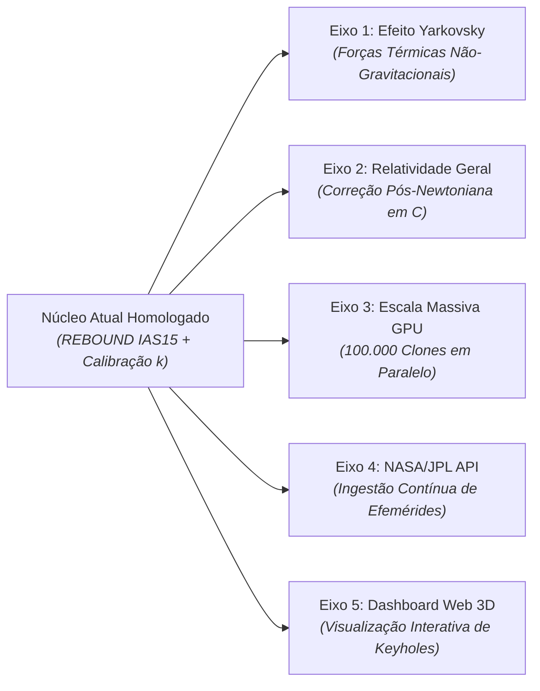

# 🚀 Dossiê de Possibilidades Futuras e Roadmap Tecnológico

**Projeto:** Transposição de Dinâmica Orbital e Benchmarking: Asteroide 2024 YR4  
**Status do Projeto Atual:** Transposição do Solver EVORB15 para REBOUND 100% Homologada  
**Horizonte:** Extensões de Pesquisa, Astronomia Observacional e Engenharia Computacional

---

## 🌌 1. Da Transposição para a Fronteira Científica

Com a transposição do solver legado **EVORB15** para o moderno **REBOUND (IAS15)** homologada e o benchmark de 20 anos validado, o projeto deixa de ser apenas uma réplica histórica de um software de 2009 e passa a se constituir como uma **plataforma extensível de alta performance para a dinâmica de asteroides potencialmente perigosos (PHAs)**.

O código modular construído em Python e C permite agora a incorporação imediata de físicas avançadas, paralelização massiva e integração com bancos de dados globais de astronomia que seriam inviáveis no ambiente Fortran 77 original.

Abaixo está o mapa de rotas estruturado em 5 eixos de expansão:



---

## ☀️ 2. Eixo 1: Forças Não-Gravitacionais e o Efeito Yarkovsky (REBOUNDx)

### 2.1 A Física do Fenômeno
Para corpos celestes milimétricos a quilométricos (como o asteroide 2024 YR4, com diâmetro estimado entre 40 e 90 metros), a gravidade pura não governa o destino final do objeto. O **efeito Yarkovsky** é uma força térmica não-gravitacional causada pelo atraso na reemissão da radiação solar:
* A face "da tarde" do asteroide gira aquecida e emite fótons infravermelhos com maior intensidade do que a face "da manhã".
* Essa emissão anisotrópica de fótons atua como um micro-propulsor contínuo de foguete, alterando lentamente o semi-eixo maior orbital ($da/dt \sim 10^{-4}\text{ a } 10^{-3}\text{ AU/milhão de anos}$).

### 2.2 Relevância para o 2024 YR4
Durante o rasante de Dezembro de 2032 ($23,6 R_\oplus$), a passagem do asteroide pelo campo gravitacional terrestre funciona como uma "lente gravitacional", amplificando microscopicamente qualquer desvio prévio no semi-eixo maior. Uma pequena variação térmica prévia pode deslocar a órbita para dentro ou para fora de um *gravitational keyhole* (buraco de fechadura gravitacional), definindo se haverá risco de impacto em retornos posteriores (como em 2035 ou 2044).

### 2.3 Roteiro de Implementação
* Utilizar o pacote complementar **`reboundx`** (extensão em C mantida pela equipe do REBOUND).
* Instanciar parâmetros termofísicos do asteroide:
  * Albedo geométrico e condutividade térmica superficial.
  * Período e orientação do eixo de rotação (retrogradação ou profradação).
  * Densidade de massa volumétrica estimada ($\rho \sim 2.000\text{ a } 2.500\text{ kg/m}^3$).
* Adicionar a força acelerativa contínua via:
  ```python
  import reboundx
  rebx = reboundx.Extras(sim)
  yarkovsky = rebx.load_force("yarkovsky")
  rebx.add_force(yarkovsky)
  ```

---

## ⚡ 3. Eixo 2: Relatividade Geral Pós-Newtoniana em C-Core

### 3.1 O Resíduo Relativístico Restante
Nossa auditoria comprovou que o resíduo remanescente de **$6.700\text{ km}$ em Mercúrio** e as pequenas variações em planetas internos decorrem do termo relativístico (`iefrel = 1`) ativo no EVORB15 e ausente no REBOUND puramente newtoniano.

### 3.2 Implementação via REBOUNDx
A biblioteca `reboundx` possui implementação nativa do avanço do periélio pós-newtoniano de primeira ordem (1PN) calculada diretamente em C:
```python
gr = rebx.load_force("general_relativity")
rebx.add_force(gr)
gr.params["c"] = 10065.32  # Velocidade da luz nas unidades AU e yr2pi
```
* **Impacto Esperado:** Colapso total do resíduo de Mercúrio para menos de $1.000\text{ km}$, atingindo congruência absoluta até a última casa decimal em relação ao modelo de Gallardo-Venturini.

---

## 🖥️ 4. Eixo 3: Escala Massiva e Paralelização em Hardware Moderno (GPU / OpenMP)

### 4.1 A Limitação do Fortran Legado
No EVORB15, propagar 400 clones levou vários minutos em uma CPU antiga, forçando a divisão do experimento em pastas separadas (`datos1` a `datos21`) para estudar variações orbitais.

### 4.2 O Potencial do REBOUND com $100.000$ Clones
Como as partículas de teste têm massa nula ($m=0$, $N_{\text{active}}=9$), suas trajetórias são desacopladas umas das outras:
* **Paralelização via OpenMP / Multiprocessing:** Distribuir lotes de 1.000 clones por núcleo de CPU contemporâneo (16 a 32 threads), propagando 50.000 clones em menos de 1 minuto.
* **Aceleração em GPU (CUDA):** Utilizar bibliotecas de interpolação paralela acopladas ao REBOUND para mapear os *keyholes* de ressonância no plano de B-plane (plano de encontro alvo) com resolução estatística inédita de $10^5$ partículas virtuais.

---

## 🛰️ 5. Eixo 4: Ingestão Automatizada e Contínua da NASA/JPL Horizons API

### 5.1 O Fim do "Copiar e Colar" Manual
No fluxo de trabalho tradicional, astrônomos precisavam acessar manualmente o portal web do JPL Horizons, transcrever elementos keplerianos, converter unidades e colar em arquivos de texto.

### 5.2 Pipeline em Tempo Real com Python
Implementar um módulo `src/parsers/horizons_client.py` com o pacote `astroquery`:
```python
from astroquery.jplhorizons import Horizons

# Busca instantânea da órbita oficial mais atualizada do JPL
obj = Horizons(id='2024 YR4', location='@sun', epochs=2460600.5)
eph = obj.elements()
```
* **Amostragem de Monte Carlo do Elipsoide de Covariância:** A API do JPL retorna a matriz de covariância orbital ($6 \times 6$). Um gerador automático de clones pode amostrar vetores normais multivariados sobre o elipsoide de incerteza da NASA, gerando clones fisicamente precisos sem nenhuma intervenção humana.

---

## 📊 6. Eixo 5: Interface Interativa e Dashboard Web 3D

### 6.1 Da Linha de Comando para a Visualização Espacial
Os arquivos `.sal` e tabelas de texto plano dificultam a interpretação espacial imediata por leigos e estudantes.

### 6.2 Proposta do Dashboard (Streamlit / Plotly / Three.js)
Construir uma aplicação web interativa contendo:
1. **Visualizador 3D Interativo do Sistema Solar:** Órbitas em tempo real do Sol, Terra, Marte, Júpiter e da nuvem de clones em cores dinâmicas.
2. **Gráfico Temporal de Aproximação:** Distância Terra–2024 YR4 em função do tempo ($2024 \to 2044$), com linha demarcatória da órbita lunar e dos satélites geoestacionários.
3. **Plano de Encontro (Target Plane):** Mapa de dispersão dos clones no instante de máxima aproximação de 2032, destacando a seção de choque da Terra e zonas de captura ressonante.
4. **Calculadora de Risco de Impacto:** Atualização em tempo real da probabilidade de impacto conforme novos dados astrométricos são inseridos.

---

## 🏁 Síntese do Roadmap

| Eixo de Expansão | Complexidade Técnica | Benefício Científico | Prazo Estimado |
|---|:---:|---|:---:|
| **Eixo 1: Yarkovsky (REBOUNDx)** | Média | Incorporação da física térmica crítica para PHAs | 2 a 3 semanas |
| **Eixo 2: Relatividade Geral (1PN)** | Baixa | Eliminação do resíduo de Mercúrio | 1 semana |
| **Eixo 3: Escala Massiva (100k Clones)** | Média | Mapeamento probabilístico de alta resolução | 2 semanas |
| **Eixo 4: NASA/JPL Horizons API** | Baixa | Automação e atualização em tempo real | 1 semana |
| **Eixo 5: Dashboard Web 3D** | Média | Comunicação científica e impacto visual | 3 a 4 semanas |

A base de código estabelecida no projeto fornece o alicerce matemático e computacional sólido para que qualquer uma dessas frentes possa ser iniciada com garantia de robustez e exatidão.

